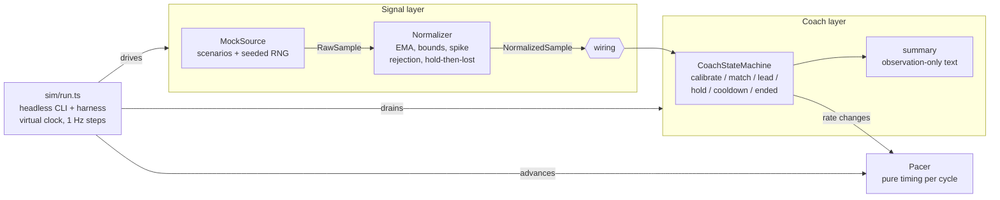

# Architecture — Breathe Together

## Phase 1 (this phase): mock-driven solo coach, headless



A single `Settings` object (`src/config.ts`) carries every tunable, documented
in one place; components receive their slice and never hard-code thresholds.

### Invariants (the design principles)

1. **Slow control loop.** The coach evaluates on multi-second windows (45 s
   Lead checks, 10 s divergence minimums, one step at a time). Nothing reacts
   to a single second of data. A camera estimate wobbling by a breath/minute
   cannot jerk the pace around.
2. **Confidence-gated.** Every data path is guarded by the normalizer's
   confidence gate and hold-then-lost window. Below-gate input repeats the
   last good value for a bounded time, then reports `lost` — and the coach
   keeps pacing steadily rather than thrashing.
3. **Never scold.** All human-facing strings (`NOTICES`, summary lines, plus
   anything Phase 2 adds) are observation-only. There is no scoring of the
   user, no verdicts, no value-laden labels. A regression test keeps the
   reserved restricted vocabulary out of summaries and notices.
4. **Deterministic time.** Components take time only from samples/injected
   clocks — never `Date.now()`. That's what makes accelerated headless
   simulation, seeded regression tests, and later real-time adapters possible
   from the same code.

### Data flow, contract-first

`SignalSource` (`src/signal/SignalSource.ts`) is the interface later
implemented by the real SmartSpectra adapter:

```ts
interface SignalSource {
  start(): void;
  stop(): void;
  onSample(cb: (s: NormalizedSample) => void): () => void; // unsubscribe
  setPacerRate?(bpm: number): void;
}
```

`NormalizedSample` carries a ms timestamp, optional smoothed breathing rate,
optional pulse, 0..1 confidence, and an observation status
(`ok / starting / no_face / poor_light / off_center / lost`) — chosen to map
cleanly from SmartSpectra's `ValidationCode` values (table in
`docs/SDK_NOTES.md §7`).

The coach consumes normalized samples only. It emits `pacer_rate_changed`
events; it never touches the `Pacer` directly. Anything that wants to drive
the pacer (the harness, Phase 2's UI loop) wires one event to one method
(`pacer.setRate`), keeping the coach testable in isolation (see the direct-feed
test in `test/stateMachine.test.ts`).

Pacer changes take effect at the next cycle boundary — a mid-breath rate
change never distorts a breath in flight.

## Phase 2+ (planned, not in this phase)

- **Real SDK source, isolated child process.** `SmartspectraSource implements
  SignalSource`. Rationale and details: SmartSpectra's native state is
  process-global, its engine is a heavy native pipeline, and one bad frame
  chunk should not take the app down — so the SDK lives in a dedicated child
  process owned and watchdogged by the host. This also lines up with the
  community report (unconfirmed) that the Node SDK misbehaved when fed 30 fps
  frames from a frontend: the child process owns the frames path
  (`useCustomInput` + `sendFrame`), subscribes to `'frameSentThrough'`
  back-pressure feedback, and restarts cleanly on `kError`.
- **WebSocket frame bridge.** Browser UI captures camera frames
  (`getUserMedia`), streams them over a local WebSocket to the Node host,
  which pipes them into the child process. Host stamping of monotonic
  timestamps (`process.hrtime.bigint()`) per the SDK's own guidance.
- **Browser UI.** Phase-1 headless harness logic is UI-agnostic; the UI
  subscribes to the same coach events (state, notice, pacer rate) plus the
  pacer snapshot breath-in/breath-out cue.
- **Pair mode.** Two independent signal→coach pipelines (one per camera),
  one shared slow tempo whose rate change steps are halved and applied only
  when both participants are inside the follow tolerance. Same constants,
  same wording rules.
- **Privacy tuning.** `enableTelemetry = false` in our wrapper by default;
  plain-language disclosure as described in `docs/SDK_NOTES.md §10` before
  any public build.

The governing sentence for everything above: **slow control loop,
confidence-gated, never scold.**
