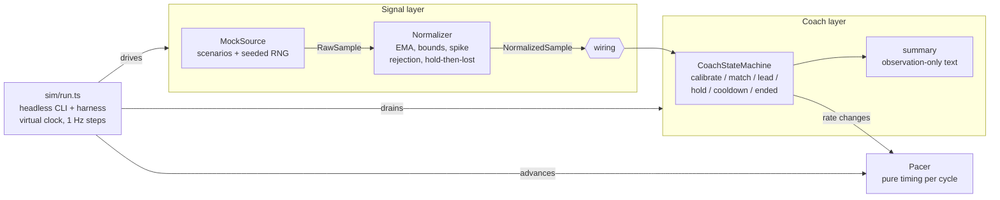
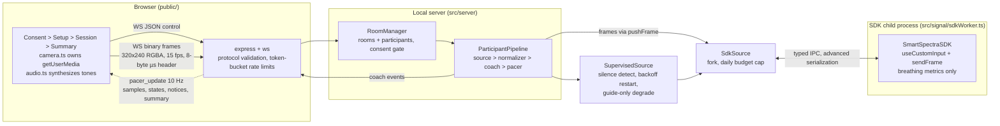
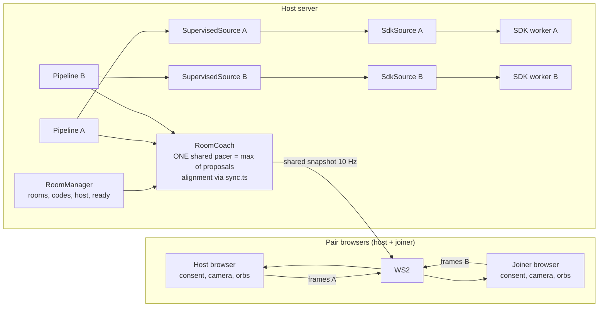

# Architecture — Breathe Together

## Phase 1 (this phase): mock-driven solo coach, headless



A single `Settings` object (`src/config.ts`) carries every tunable, documented
in one place; components receive their slice and never hard-code thresholds.

### Invariants (the design principles)

1. **Slow control loop.** The coach evaluates on multi-second windows (45 s
   Lead checks, 10 s divergence minimums, one step at a time). Nothing reacts
   to a single second of data. A camera estimate wobbling by a breath/minute
   cannot jerk the pace around.
2. **Confidence-gated.** Every data path is guarded by the normalizer's
   confidence gate and hold-then-lost window. Below-gate input repeats the
   last good value for a bounded time, then reports `lost` — and the coach
   keeps pacing steadily rather than thrashing.
3. **Never scold.** All human-facing strings (`NOTICES`, summary lines, plus
   anything Phase 2 adds) are observation-only. There is no scoring of the
   user, no verdicts, no value-laden labels. A regression test keeps the
   reserved restricted vocabulary out of summaries and notices.
4. **Deterministic time.** Components take time only from samples/injected
   clocks — never `Date.now()`. That's what makes accelerated headless
   simulation, seeded regression tests, and later real-time adapters possible
   from the same code.

### Data flow, contract-first

`SignalSource` (`src/signal/SignalSource.ts`) is the interface later
implemented by the real SmartSpectra adapter:

```ts
interface SignalSource {
  start(): void;
  stop(): void;
  onSample(cb: (s: NormalizedSample) => void): () => void; // unsubscribe
  setPacerRate?(bpm: number): void;
}
```

`NormalizedSample` carries a ms timestamp, optional smoothed breathing rate,
optional pulse, 0..1 confidence, and an observation status
(`ok / starting / no_face / poor_light / off_center / lost`) — chosen to map
cleanly from SmartSpectra's `ValidationCode` values (table in
`docs/SDK_NOTES.md §7`).

The coach consumes normalized samples only. It emits `pacer_rate_changed`
events; it never touches the `Pacer` directly. Anything that wants to drive
the pacer (the harness, Phase 2's UI loop) wires one event to one method
(`pacer.setRate`), keeping the coach testable in isolation (see the direct-feed
test in `test/stateMachine.test.ts`).

Pacer changes take effect at the next cycle boundary — a mid-breath rate
change never distorts a breath in flight.

## Phase 2 (built): browser app + real SDK in an isolated process



Key points:

- **Rooms are pair-ready.** A room owns participants; solo is a room of one.
  Every wire message carries `roomId`/`participantId` from the start, so pair
  mode later is "add a participant", not a protocol rewrite.
- **The server never trusts client numbers.** JSON control messages carry no
  signal data; camera frames feed only SDK-mode sources and are counted
  (rate-limited) in mock mode.
- **Pacer sync (10 Hz + client interpolation, chosen over event-only).**
  The server pushes a pacer snapshot every 100 ms. The client advances each
  snapshot's phase progress linearly — the same math the server `Pacer`
  uses within a phase — and re-anchors on every snapshot. Error is therefore
  bounded by one push interval by construction, and a reconnect resyncs
  deterministically. `src/client/orb.test.ts` measures this bound against
  the real `Pacer` over a simulated 10-minute session (max scale error
  ≤ 0.03, phase disagreement ≤ one push interval).
- **Failure modes.** Signal loss → normalizer holds, then `lost`; the pacer
  keeps cycling and the UI shows a calm notice. Source crash → supervisor
  restarts with backoff (max 3), then degrades to guide-only (steady pacer,
  no sensing) with an honest notice. Camera denied → guide-only offer.
  WebSocket drop → session ends, camera off, reconnect offered. The SDK
  child is spawned only for a session and killed on stop/consent-revoke.
- **Privacy surface.** The worker sets `enableTelemetry: false`. Nothing is
  logged except counters and ids. See `docs/CONSENT_AND_DATA.md`.

## Pair mode (Phase 3): two browsers, one host, one shared pacer



- **Shared pacer rule (3d):** shared rate = max of the two solo coaches'
  proposals — the gentler (slower-to-descend) one wins. A shared Lead step
  therefore needs both coaches proposing it; one lost participant holds the
  shared rate steady.
- **Alignment (3c):** `sync.ts` blends rate agreement + guide-following (min
  of the two), smoothed with τ ≥ 30 s (the reporting window) and a
  hysteresis band; freezes when either side is unobservable, shows
  "waiting" after 30 s frozen. **All thresholds UNVALIDATED** (no
  real-face data exists yet — see `docs/PAIR_DESIGN.md`).
- **PeerLink seam:** `RoomCoach` and `sync.ts` consume abstract feeds
  (proposals, states, normalized samples) — never sockets — so a future
  relay topology (local instances, abstract values only) can reuse them.
- **Privacy:** the server never relays raw frames to the peer and never
  relays rates unless that participant opted in (tested). Consent is per
  person; the joiner's consent screen names the host as the recipient of
  their frames.
- **Quota:** each side's usage is counted per participant-minute (two
  workers run concurrently); pair starts are refused when the remaining
  budget can't cover the session.

## Later (not in this phase)

- **Relay topology** (each person runs a local instance; only abstract
  values travel through a relay) — described in `docs/PAIR_DESIGN.md §3a`
  as designed-but-not-built.

The governing sentence for everything above: **slow control loop,
confidence-gated, never scold.**
